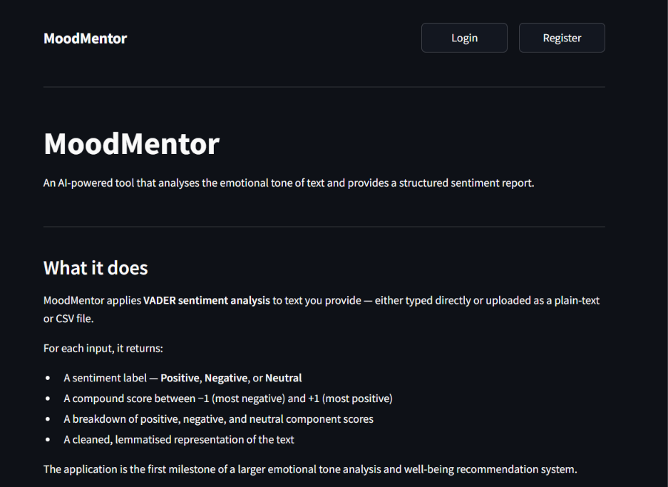
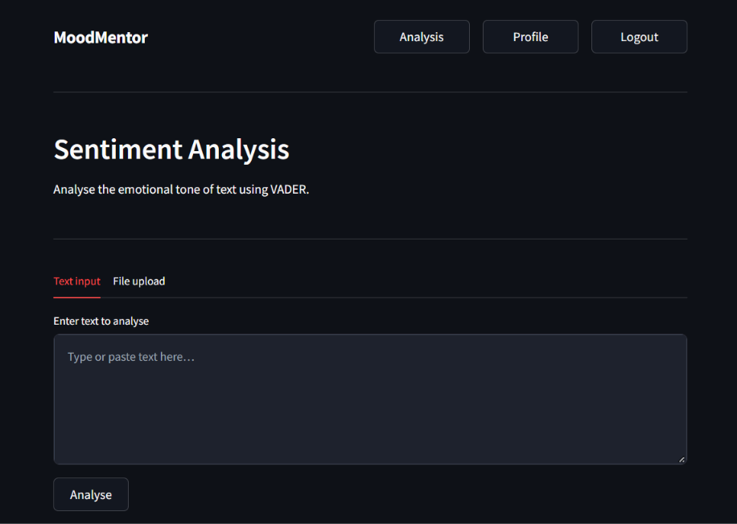
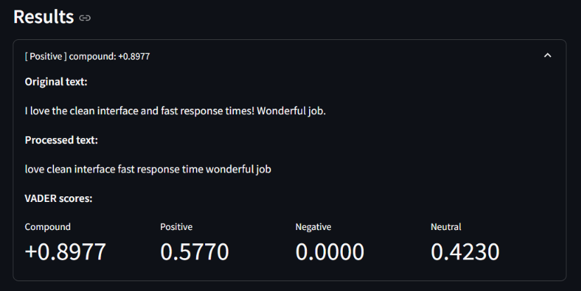

# MoodMentor – AI-Powered Emotional Tone Analyzer

**MoodMentor** is a full-stack AI web application that analyses the emotional tone of text using natural language processing and VADER sentiment analysis. Users can type text directly or upload `.txt` and `.csv` files to receive instant, structured sentiment reports.

Developed as part of the **Infosys Springboard Internship**.

---

## 📸 Screenshots

| Landing Page | Sentiment Analysis Dashboard |
| :---: | :---: |
|  |  |

<p align="center">
  <b>Analysis Results & Score Breakdown</b><br>
  
</p>

---

## ⚡ Features

- **Authentication:** User registration & login with **bcrypt** password hashing and **JWT** session tokens.
- **NLP Preprocessing:** Text cleaning with **spaCy** & **NLTK** (tokenisation, lemmatisation, stop-word filtering, negation preservation).
- **VADER Sentiment Analysis:** Categorises text into **Positive**, **Negative**, or **Neutral** with fine-grained compound and component scores.
- **File Upload Support:** Upload and process plain text (`.txt`) and tabular (`.csv`) datasets in bulk.
- **Full-Stack Architecture:** Decoupled **FastAPI** backend with **MySQL (SQLAlchemy)** and an interactive **Streamlit** frontend.

---

## 🛠️ Tech Stack

- **Frontend:** Streamlit
- **Backend:** FastAPI, Uvicorn
- **Database:** MySQL, SQLAlchemy ORM
- **NLP / ML:** spaCy (`en_core_web_sm`), NLTK, VADER (`vaderSentiment`)
- **Security:** Passlib (bcrypt), python-jose (JWT)

---

## 🚀 Quickstart

### 1. Configure Environment
Create `.env` from template:
```powershell
Copy-Item .env.example .env
```
Fill in your MySQL credentials and JWT secret in `.env`.

### 2. Initialize Database
```powershell
python init_db.py
```

### 3. Start Backend API
```powershell
python -m uvicorn backend.main:app --reload --port 8000
```
*API Docs: http://127.0.0.1:8000/docs*

### 4. Start Frontend UI
In a second terminal:
```powershell
python -m streamlit run frontend/app.py --server.port 8501
```
*App: http://localhost:8501*

---

## 🔌 API Endpoints

| Method | Endpoint | Auth | Description |
|---|---|---|---|
| `GET` | `/health` | No | Service health check |
| `POST` | `/auth/register` | No | Register new user account |
| `POST` | `/auth/login` | No | Authenticate & receive JWT token |
| `GET` | `/auth/me` | Yes | Get authenticated user info |
| `GET` | `/profile/` | Yes | View user profile |
| `PUT` | `/profile/` | Yes | Update user display name |
| `POST` | `/sentiment/analyze` | Yes | Analyze raw text string |
| `POST` | `/sentiment/analyze-file` | Yes | Bulk analyze `.txt` or `.csv` files |

---

## 📂 Project Structure

```
moodmentor/
├── backend/
│   ├── main.py              # FastAPI application entry point
│   ├── database.py          # SQLAlchemy engine & session factory
│   ├── models/              # ORM models & Pydantic schemas
│   ├── routes/              # Auth, profile, and sentiment endpoints
│   └── services/            # Hashing, JWT auth & NLP/VADER logic
├── frontend/
│   ├── app.py               # Streamlit entry point & navigation
│   ├── api_client.py        # HTTP client communicating with backend
│   └── page_*.py            # UI pages (home, auth, analysis, profile)
├── screenshots/             # Application screenshots
├── init_db.py               # Database initialization script
├── requirements.txt         # Project dependencies
└── README.md                # Quick lookup guide
```
